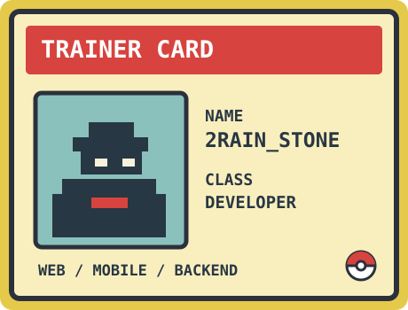

<div align="center">


### ⚡ A wild developer appeared!

**`TRAINER: 2RAIN_STONE`** · **`REGION: SOUTH KOREA`** · **`CLASS: FULL-STACK DEVELOPER`**

[](https://github.com/Leeuseok)
[](mailto:dntjr4646@gmail.com)
[](https://www.instagram.com/2rain_stone)

</div>

---

## 🪪 TRAINER CARD

<table>
<tr>
<td width="38%" align="center">

</td>
<td width="62%">

```text
┏━━━━━━━━━━━━━━━━━━━━━━━━━━━━━━┓
┃         TRAINER INFO         ┃
┣━━━━━━━━━━━━━━━━━━━━━━━━━━━━━━┫
┃ NAME    : 2rain_stone       ┃
┃ TYPE    : WEB / MOBILE / API┃
┃ REGION  : SOUTH KOREA       ┃
┃ STATUS  : EXPLORING...      ┃
┗━━━━━━━━━━━━━━━━━━━━━━━━━━━━━━┛
```

> 화면부터 API까지, 하나의 서비스로 연결합니다.  
> TypeScript로 웹과 모바일을, Java와 Spring Boot로 백엔드를 개발합니다.

</td>
</tr>
</table>

## 🎒 MY POKéMON PARTY — TECH STACK

| SLOT | PARTNER | SPECIAL MOVE |
| :---: | :--- | :--- |
| 🔥 01 | **TypeScript · JavaScript** | TYPE SAFETY / UI LOGIC |
| ⚡ 02 | **React · React Native · Expo** | WEB & MOBILE BUILD |
| 🌿 03 | **Java 21 · Spring Boot** | BACKEND API |
| 💧 04 | **PostgreSQL · JPA** | DATA MODELING |
| 🌀 05 | **Redis** | CACHING |
| ✨ 06 | **Zustand · TanStack Query** | STATE & SERVER DATA |

## 📟 POKéDEX — ADVENTURE LOG

```text
╔══════════════════════════════════════════╗
║              CURRENT QUESTS              ║
╠══════════════════════════════════════════╣
║  ▶ WEB → MOBILE                          ║
║    React services & admin dashboards     ║
║    React Native / Expo applications      ║
║                                          ║
║  ▶ API → DATA                            ║
║    Spring Boot APIs, auth & caching      ║
║    PostgreSQL / JPA / Redis              ║
╚══════════════════════════════════════════╝
```

## 🏆 TRAINER RECORD

<div align="center">


</div>

---

<div align="center">

**`▶ SAVE GAME?`**  **`YES`** / `NO`

*Thanks for visiting my developer Pokédex!*


</div>
