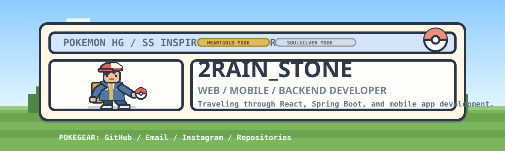
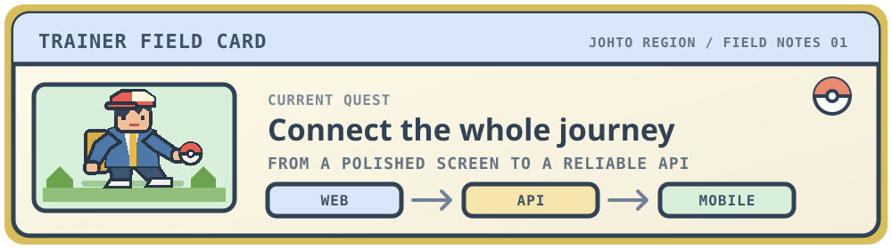
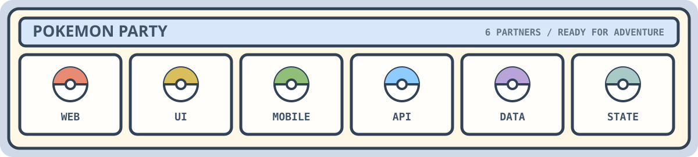

# 2rain_stone의 개발 도감

### 📡 Pokégear Online

> **트레이너** `2rain_stone` · **클래스** `Full-Stack Developer` · **지역** `South Korea`

`화면에서 서버까지, 하나의 경험으로 연결하는 개발자`

---

## 🪪 트레이너 카드

  

| 능력치 | 현재 레벨 |
|:--|:--|
| **최근 퀘스트** | 콘텐츠 자동화 · 역사 여행 앱 발자취 · 관리자 대시보드 |
| **주력 언어** | TypeScript · JavaScript · Python · Java |
| **Web / Mobile** | React 19 · Next.js 15 · Vite · Tailwind CSS · React Native · Expo 54 |
| **API / Automation** | Threads API · GitHub Actions · Axios · 카카오·네이버 로그인 · Spring Boot |
| **Data / State** | TanStack Query · Zustand · Firebase · Redux Toolkit · JSON Server · JPA |
| **특성** | 반복 작업을 자동화하고, 화면부터 데이터 흐름까지 직접 연결합니다 |

---

## 🎒 현재 파티

  

| 슬롯 | 파트너 | 타입 · 기술 | 파티에서의 역할 |
|:--:|:--|:--|:--|
| `01` | **Python Automation** | ⚙️ Steel · `Auto Publish` | 예약 발행, 인사이트 수집, 콘텐츠 재활용 |
| `02` | **GitHub Actions · API** | ⚡ Electric · `Schedule Trigger` | PC 없이도 정해진 시간에 워크플로 실행 |
| `03` | **Next.js · React · TypeScript** | 🔮 Psychic · `Admin Vision` | 관리 기능과 데이터 대시보드 구성 |
| `04` | **React Native · Expo · Zustand** | 🪽 Flying · `Field Trip` | 소셜 로그인, 위치 기반 방문 인증, 스탬프·커뮤니티 흐름 연결 |
| `05` | **Axios · Redux Toolkit** | 💧 Water · `Data Flow` | CRUD, 인터셉터, 로딩·에러·전역 상태 관리 |
| `06` | **Java · Spring Boot · Flutter** | 🔥 Fire · `Legacy Route` | REST API와 모바일 앱 프로젝트 경험 |

---

## 📖 최근 프로젝트 도감

<b>No.001 — 사내 업무 웹 서비스</b> <code>2025.10–현재</code> Company · Front-end

 
재직 중인 회사에서 업무용 웹 서비스의 프론트엔드 화면을 구현하고 있습니다. 
React 19, TypeScript, Vite, Tailwind CSS를 바탕으로 TanStack Query·Table·Virtual, Zustand, Axios를 사용해 데이터 조회·대용량 테이블·폼 화면을 만들고, 엑셀·PDF 처리 기능도 다룹니다.

<b>No.002 — Threads 콘텐츠 자동 게시 봇</b> <code>2026.10</code> Private

 
Python과 Threads API를 연결해 하루 5회 예약 발행하고, GitHub Actions로 스케줄을 자동화했습니다. 
매일 조회수를 수집해 성과가 좋은 글을 선별하며, 14일 후 문장을 새로 작성해 재게시하는 흐름을 구성했습니다. 
유사도 60% 초과 차단, 일일 재게시 제한, 광고 문구 자동 삽입 등 운영 규칙도 코드에 포함했습니다.

<b>No.003 — 발자취 · 역사 인물 여행 앱</b> <code>2026.05–09</code> Team · Front-end

 
역사 인물의 발자취를 따라 코스를 걷고, 위치 기반 방문 인증으로 스탬프를 모으는 모바일 앱입니다. 
React Native(Expo 54), TypeScript, Zustand, Axios로 앱 프론트엔드를 맡아 팀 커밋의 약 2/3를 담당했습니다. 
카카오·네이버 소셜 로그인, 코스 상세·커스텀 코스·내 여행·스탬프 API 연동, 위치 권한 안내와 방문 인증, 주변 추천 장소, 네이버 지도 길찾기를 구현했습니다. 
공통 얼럿 모달, 당겨서 새로고침, 화면 복귀 시 재조회 등 사용성을 다듬고 운영 서버 연결과 Android 빌드까지 진행했으며, React·Vite 기반 관리자 페이지의 API 정합성 보정에도 참여했습니다.

<b>No.004 — <a href="https://github.com/Leeuseok/community_app">Community App MVP</a></b> <code>2025.09</code>

 
React Native, Expo, TypeScript, Firebase로 모바일 커뮤니티 MVP를 만들었습니다. 
회원가입·로그인부터 게시글 작성·목록·상세, 댓글, 이미지 선택과 업로드까지 커뮤니티의 핵심 흐름을 구현했습니다.

<b>No.005 — <a href="https://github.com/Leeuseok/next_admin">Next Admin Dashboard</a></b> <code>2025.07</code>

 
Next.js 15, React 19, TypeScript로 관리자 화면을 구성했습니다. 
사용자·직원·결제·문의·콘텐츠·알림·권한·설정 화면과 통계 카드, 차트, 테이블, 필터, 모달을 기능별 컴포넌트와 훅으로 분리했습니다.

<b>No.006 — <a href="https://github.com/Leeuseok/next">Next.js API & State Lab</a></b> <code>2025.06</code>

 
Axios 인스턴스와 인터셉터, JSON Server를 이용해 CRUD와 네트워크 오류 처리를 실습했습니다. 
Redux Toolkit과 커스텀 훅으로 API 데이터와 전역 상태를 분리하고, 비동기 화면의 로딩·오류 흐름을 다뤘습니다.

---

## 🗺️ 모험 기록

| 시기 | 체크포인트 | 획득 경험 |
|:--:|:--|:--|
| **2025.10–현재** | 사내 업무 웹 서비스 | React · TypeScript · TanStack Query · 실무 협업 |
| **2026.10** | Threads 자동 게시 봇 | Python · 외부 API · GitHub Actions · 운영 자동화 |
| **2026.05–09** | 발자취 (팀 프로젝트) | React Native · Expo · 소셜 로그인 · 위치 인증 · 협업 |
| **2025.09** | [Community App](https://github.com/Leeuseok/community_app) | Expo · Firebase · 인증 · 이미지 업로드 |
| **2025.07** | [Next Admin](https://github.com/Leeuseok/next_admin) | Next.js · TypeScript · 관리자 UI · 데이터 시각화 |
| **2025.06** | [Next API Lab](https://github.com/Leeuseok/next) | Axios · Redux Toolkit · JSON Server · CRUD |
| **2025.01–02** | [Calendar](https://github.com/Leeuseok/Calendar) · [FastAPI Planner](https://github.com/Leeuseok/FastAPI_planner) | Flutter · Python · 일정 관리 |
| **2024.12** | [Spring REST API](https://github.com/Leeuseok/springboot-restapi) · [Spring Blog](https://github.com/Leeuseok/springboot_blog) | Java · Spring Boot · REST API |

---

## 🏆 명예의 전당

  
  

  

---

## 🎖️ 획득한 배지

| 배지 | 성장 기록 |
|:--|:--|
| ⚙️ **Automation Badge** | 예약 실행부터 성과 수집·재활용까지 반복 업무 자동화 |
| 📊 **Admin Badge** | 여러 관리 도메인을 일관된 테이블·폼·모달 구조로 구성 |
| 🐝 **Community Badge** | 인증, 게시글, 댓글, 이미지가 이어지는 모바일 흐름 구현 |
| 🧭 **Explorer Badge** | 팀 프로젝트에서 소셜 로그인·위치 인증·스탬프를 운영 서버와 앱 빌드까지 연결 |
| 🌫️ **API Badge** | Threads API와 Axios 기반 REST 요청·오류 처리 경험 |
| 🔥 **Backend Badge** | FastAPI와 Spring Boot로 CRUD 및 REST API 구현 |
| 🐉 **Rising Badge** | 웹·모바일·자동화를 넘나들며 실제 문제 중심으로 확장 중 |

---

## 💬 Pokégear 메시지

> 좋은 트레이너는 각 파트너의 강점을 연결하고, 
> 좋은 개발자는 기술을 연결해 하나의 경험을 만듭니다.

**방문해 주셔서 감사합니다!** 
다음 체크포인트를 향해 계속 진화하는 중입니다. ✨

